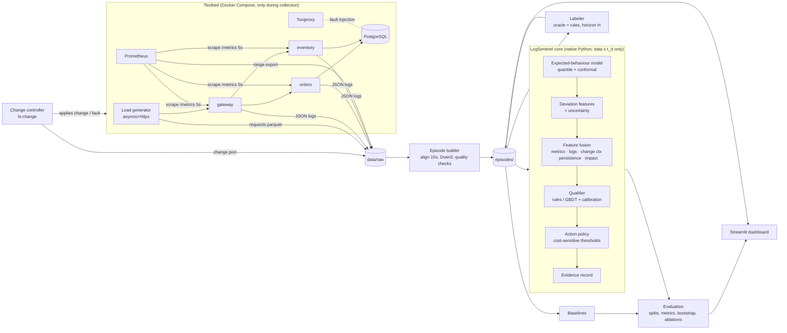

# Architecture — v0

The design keeps **anomaly evidence**, **qualification decisions** and **operational actions** as
separate components with separate records, so ablations can remove any one of them.

## Components and records

| Component | Package | Input | Output record |
|---|---|---|---|
| Change controller | `orchestrator/` | scenario manifest, seed | `change.json`, `scenario.json` (oracle) |
| Collector | `logsentinel/collect` | Prometheus API, log files, request log | `data/raw/<run_id>/*` |
| Episode builder | `logsentinel/episodes` | raw run | `series.parquet`, `logs.parquet`, manifest row |
| Labeler | `logsentinel/episodes/labeler.py` | episode **+ oracle**, full horizon | `label.json` (+ evidence) |
| Expected-behaviour model | `logsentinel/expected` | W_pre, change metadata, workload | per-metric expected value + interval |
| Features | `logsentinel/features` | episode up to t_d, expectations | feature vector + named evidence |
| Baselines | `logsentinel/detectors` | episode up to t_d | alarm/score |
| Qualifier | `logsentinel/qualify` | features | class probabilities |
| Policy | `logsentinel/qualify/policy.py` | probabilities, cost matrix | action |
| Explanation | `logsentinel/explain` | features, rule hits / SHAP | human-readable evidence |

**Information barrier.** Only the labeler and the evaluator may read `scenario.json` (oracle) or data
after `t_d`. `logsentinel.features` receives a `cutoff` argument and is unit-tested to never return
values derived from data after it.

**No remediation.** The policy outputs recommendations. No component executes a rollback.
